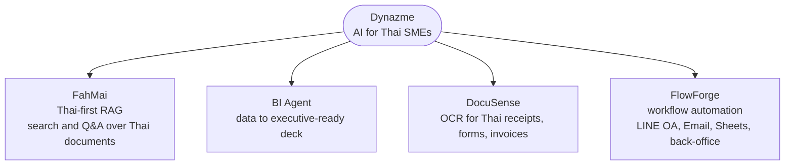

# Dynazme

**AI engineering for Thai SMEs.**

   

> Public placeholder repository. Source code, customer work and internal planning live in a private repository.

## Tech stack

  

## Product lines

---

> AI engineering for Thai SMEs.

---

## Status

🚧 **In active development.** No paying customers yet.

This repository is a public placeholder. Implementation source code, customer work, and internal planning live in a private repository.

---

## Why Dynazme exists

Most AI tools today are designed for English-speaking markets and priced for foreign budgets.
Local consultancies serve enterprises, not SMEs.

Thai SMEs need AI that works in Thai, fits a Thai workflow, and costs what a Thai business can afford. Dynazme is being built to close that gap.

---

## What Dynazme builds

Four product lines, all designed for Thai-language and Thai-business contexts:

- **FahMai** — Thai-first RAG: search and Q&A across Thai documents
- **BI Agent** — Data → executive-ready presentation
- **DocuSense** — OCR for Thai documents (receipts, forms, invoices)
- **FlowForge** — AI workflow automation across LINE OA, Email, Sheets, and back-office systems

See [`PRODUCTS.md`](./PRODUCTS.md).

---

## Contact

See [`CONTACT.md`](./CONTACT.md). For security findings, see [`SECURITY.md`](./SECURITY.md).

---

© 2026 Dynazme — All Rights Reserved · [`LICENSE`](./LICENSE)
